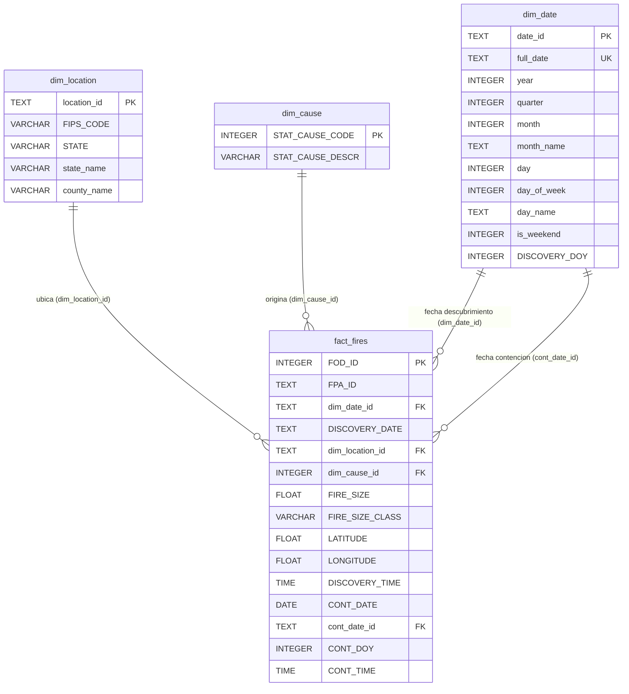

# Modelado del esquema Denormalizado

Investigación sobre la evolución temporal y espacial de los incendios en los estados de California, Texas y Oregon de Estados Unidos entre 1992 y 2015

## Diccionario de datos

Cada campo se documenta con su tipo, su origen en la fuente cruda, su dominio de
valores y las observaciones de calidad detectadas durante el ETL.

**Convención de la columna "Origen":**
- `FUENTE` — el campo proviene partiendo de la base de datos limpia y normalizada.
- `CONSTRUIDO` — clasificación elaborada por el investigador; no existe en la fuente.

---

## Tabla de hechos: `fact_fires`

**Granularidad:** un registro por incendio detectado. **Filas:** 167.215.

| Campo | Tipo | Origen | Campo fuente | Descripción |
|---|---|---|---|---:|
| `FOD_ID` | INTEGER PK | FUENTE | `FOD_ID` | Identificador global único del incendio en la FPA FOD. Garantiza la trazabilidad de cualquier fila hasta el registro original. | 0% |
| `dim_date_id` | TEXT FK | CONSTRUIDO | `CONT_DATE` | Llave foránea hacia `dim_date`. |
| `DISCOVERY_DATE` | TEXT | FUENTE | `DISCOVERY_DATE` | Fecha de detección en formato ISO (`AAAA-MM-DD`). |
| `dim_location_id` | TEXT FK | CONSTRUIDO | `FIPS_CODE`, `STATE` | Llave foránea hacia `dim_location`. Resultado de normalizar la combinación código fips-estado. |
| `dim_cause_id` | INTEGER FK | FUENTE | `STAT_CAUSE_CODE` | Llave foránea hacia `dim_cause`. Convertido de `float64` a entero. Dominio: 1–13. |
| `FIRE_SIZE` | FLOAT | FUENTE | `FIRE_SIZE` | Tamaño del incendio (acres, hectáreas). |
| `FIRE_SIZE_CLASS` | VARCHAR | FUENTE | `FIRE_SIZE_CLASS` | Clase del tamaño del incendio (tipo A, B...). |
| `latitude` | FLOAT | FUENTE | `LATITUDE` | Latitud del punto de origen en grados decimales. Datum NAD83. |
| `longitude` | FLOAT | FUENTE | `LONGITUDE` | Longitud del punto de origen en grados decimales. Datum NAD83. |
| `DISCOVERY_TIME` | TEXT | FUENTE | `DISCOVERY_TIME` | Hora de detección en formato `HHMMSS`. **No interviene en ninguna medida reportada**; se conserva por completitud. |
| `CONT_DATE` | DATE | FUENTE | `CONT_DATE` | Fecha de contención. cuya información se distribuye en la dimensión `dim_date`. |
| `cont_date_id` | DATE FK | CONSTRUIDO | `CONT_DATE` | Llave foránea hacia `dim_date`. comparte la clave con `dim_date_id`. |

---

## Dimensión: `dim_date`

**La variable segmentadora de la investigación.** No existe en la fuente: es una
construcción del equipo. **Filas:** 8.767.

| Campo | Tipo | Descripción |
|---|---|---|
| `date_id` | TEXT PK | Identificador de la categoría. |
| `full_date` | TEXT | Fecha completa documentada. |
| `year` | INTEGER | Año del incendio. |
| `quarter` | INTEGER | Cada tres meses de incendios. |
| `month` | INTEGER | Mes del año del incendio. |
| `month_name` | TEXT | Nombre del mes. |
| `day` | INTEGER | Día del incendio. |
| `day_of_week` | INTEGER | Día de la semana del incendio. |
| `day_name` | TEXT | Nombre del día de la semana del incendio. |
| `is_weekend` | INTEGER | Fin de semana o no. (0 no, 1 sí)|
| `DISCOVERY_DOY` | INTEGER | Día juliano de descubrimiento del incendio. |

> **Nota metodológica.** 
> Los datos de año, mes y día se juntaron como llave primaria convirtiéndola en texto
> para evitar duplicaciones en las filas.

---

## Dimensión: `dim_cause`

**La variable segmentadora de la investigación.** No existe en la fuente: es una
construcción del equipo. **Filas:** 13.

| Campo | Tipo | Descripción |
|---|---|---|
| `STAT_CAUSE_CODE` | INTEGER PK | Identificador de la categoría. |
| `STAT_CAUSE_DESC` | VARCHAR | Causa del incendio. |

---

## Dimensión: `dim_location`

**La variable segmentadora de la investigación.** No existe en la fuente: es una
construcción del equipo. **Filas:** 351.

| Campo | Tipo | Descripción |
|---|---|---|
| `location_id` | TEXT PK | Identificador de la categoría. |
| `FIPS_CODE` | VARCHAR | identificador numérico de la locación geográfica del incendio. |
| `STATE` | VARCHAR | Estado del incendio por siglas postales "CA, OR, TX...". |
| `state_name` | VARCHAR | Nombre del estado del incendio. |
| `county_name` | VARCHAR | Nombre del condado del incendio. |

---

## Esquema del modelo denormalizado

