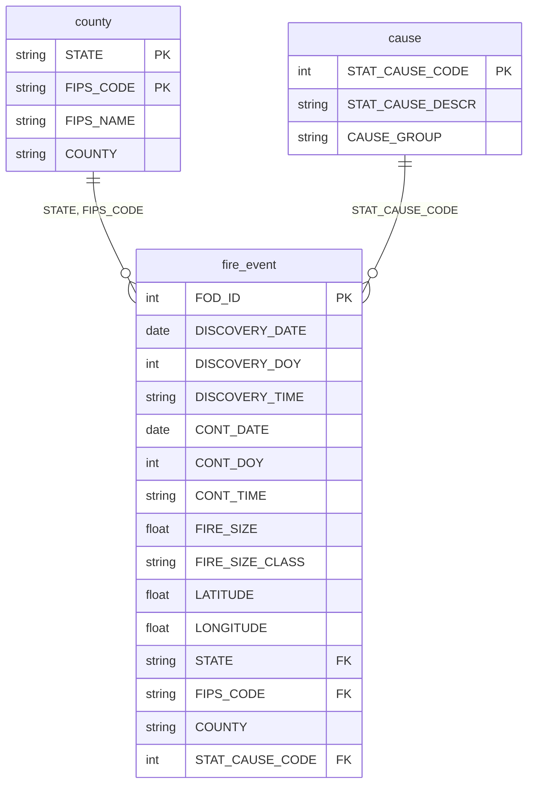

# Modelado de Datos del Esquema Normalizado
Documentación del diseño de la base de datos de la investigación "Análisis de la evolución temporal y espacial de los incendios en los estados de California, Texas y Oregon de Estados Unidos entre 1992 y 2015".

## 1. Punto de partida: fuente cruda
La base descargada de Kaggle (FPA_FOD_20170508.sqlite, ~777 MB) recopila y registra los incendios forestales ocurridos en Estados Unidos desde 1992 hasta 2015. El conjunto de datos detalla para cada incidente variables clave como la temporalidad de los eventos, su ubicación espacial mediante coordenadas de latitud y longitud, la magnitud y clasificación del tamaño en acres. Contiene una tabla principal plana llamada Fires con 39 columnas y 1,880,465 filas.

 Sus problemas estructurales principales eran:
| Problema | Manifestación en la fuente | 
|--|---|
|**Redundancia**| Texto repetidos millones de veces como vienen siendo la causa y el nombre del condado donde ocurrió el incendio|
|**Mezcla de dominios**|Datos de distinta naturaleza conviviendo en una sola fila: IDs de registro, fechas, coordenadas geográficas y  tamaños en acres |
|**Formatos incompatibles**| Las fechas venían en formato Juliano y las horas como texto (ej. "1300"), lo que impedía cálculos directos|
|**Valores nulos**| Presencia masiva de datos faltantes en variables críticas, como la hora de inicio  y en algunos de los códigos de condado.|

Adicionalmente, la fuente contenía datos de los 52 estados de EE. UU., por lo que fue necesario aplicar un filtro geográfico para aislar la muestra de estudio.

## 2. Modelo Lógico: Esquema normalizado en 3FN
El modelo resultante consta de una tabla principal  y dos secundarias.

## 2.1 Inventario de Tablas

|Tabla| Filas| Función en el modelo|
|--|--|--|
|`fire_event`| 167.215|Registra las características del incendio (fechas, tamaño, ubicación) y conecta con las demás tablas.|
|`county`|348| Nombre de los condados y su código FIPS.|
|causa| 13| Causas estadísticas de inicio del fuego.|

