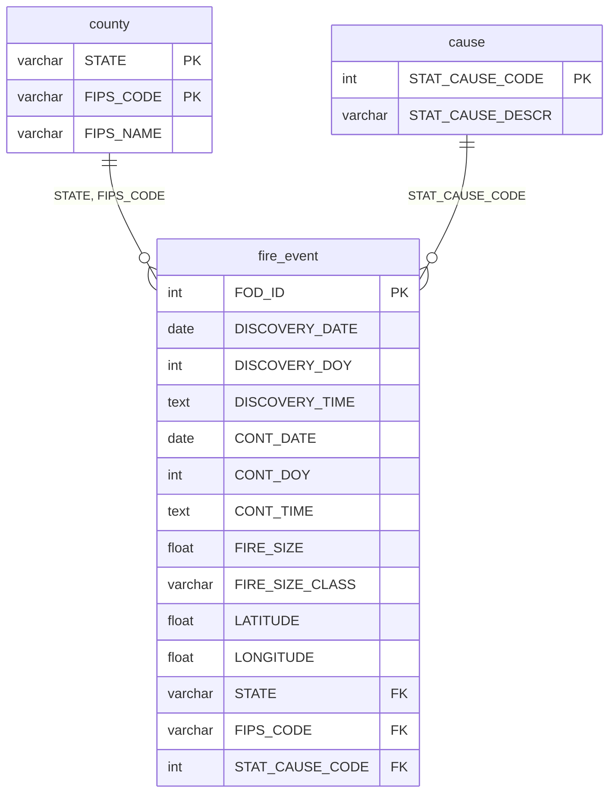

# Modelado de Datos del Esquema Normalizado
Documentación del diseño de la base de datos de la investigación "Análisis de la evolución temporal y espacial de los incendios en los estados de California, Texas y Oregon de Estados Unidos entre 1992 y 2015".

## 1. Punto de partida: fuente cruda
La base descargada de Kaggle (FPA_FOD_20170508.sqlite, ~777 MB) recopila y registra los incendios forestales ocurridos en Estados Unidos desde 1992 hasta 2015. El conjunto de datos detalla para cada incidente variables clave como la temporalidad de los eventos, su ubicación espacial mediante coordenadas de latitud y longitud, la magnitud y clasificación del tamaño en acres. Contiene una tabla principal plana llamada Fires con 39 columnas y 1,880,465 filas.

 Sus problemas estructurales principales eran:
| Problema | Manifestación en la fuente | 
|--|---|
|**Redundancia**| Texto repetidos millones de veces como vienen siendo la causa y el nombre del condado donde ocurrió el incendio|
|**Mezcla de dominios**|Datos de distinta naturaleza conviviendo en una sola fila: IDs de registro, fechas, coordenadas geográficas y  tamaños en acres |
|**Formatos incompatibles**| Las fechas venían en formato Juliano y las horas como texto (ej. "1300"), lo que impedía cálculos directos|
|**Valores nulos**| Presencia masiva de datos faltantes en variables críticas, como la hora de inicio  y en algunos de los códigos de condado.|

Adicionalmente, la fuente contenía datos de los 52 estados de EE. UU., por lo que fue necesario aplicar un filtro geográfico para aislar la muestra de estudio.

## 2. Modelo Lógico: Esquema normalizado en 3FN
El modelo resultante consta de una tabla principal  y dos secundarias.

## 2.1 Inventario de Tablas

|Tabla| Filas| Función en el modelo|
|--|--|--|
|`fire_event`| 167.215|Registra las características del incendio (fechas, tamaño, ubicación) y conecta con las demás tablas.|
|`county`|348| Nombre de los condados y su código FIPS.|
|`causa`| 13| Causas estadísticas de inicio del fuego.|

## 3. Decisiones de diseño y su justificación

### 3.1 ¿Por qué se eliminaron los registros sin hora de inicio?
Durante el proceso de limpieza , se detectó que el 47% de los registros no contaban con la columna DISCOVERY_TIME (hora de descubrimiento). Se eliminaron estos registros del análisis debido a que para el estudio de estacionalidad y duración exacta, no era posible imputar la hora de inicio sin asumir información que sesgara los resultados. 

### 3.2 La dependencia transitiva en las causas
La descripción de la causa  no depende del incendio en sí, sino del código de causa. Si la descripción viviera en la tabla de `fire_event`, se almacenaría la misma palabra más de una vez. Como solución se creó la tabla cause como catalogo para almacenar las 13 causas posibles.

### 3.3 Llave compuesta en la tabla `cause`
El FIPS_CODE por sí solo no es único a nivel nacional, el código "001" existe en decenas de estados. Por ello, la llave primaria de la tabla county es una llave compuesta: (STATE, FIPS_CODE). La tabla de `fire_event` se conecta a ella mediante ambas columnas.

## 4. Transformaciones aplicadas en el ETL
|Transformación | Detalle |
|--|--|
|Conversión de fechas julianas | La fuente guarda un número real (día juliano). Se convierte a ISO (YYYY-MM-DD) con la función date|
|Conversión de causas| STAT_CAUSE_CODE venía como float64 . Se convierte a entero  para que coincida con la llave primaria de la tabla cause|
|Relleno de FIPS_CODE nulos| A los incendio que no tenían código FIPS se le asignó el código ‘000’ para no perder el registro|
|Imputación a la hora de contención | Cálculo de promedios de duración por clase y suma a la hora de descubrimiento|

# Diccionario de Datos 
Cada campo se documenta con su tipo, origen y las observaciones detectadas durante el proceso ETL 

### Convención de Origen
*   **FUENTE:** Proviene directamente de la tabla original `Fires` de Kaggle.
*   **DERIVADO:** Transformado durante el proceso de normalización y limpieza.

## Tabla `fire_event`

| Campo | Tipo | Origen | Descripción | Nulos |
|--|--|--|--|--|
| `FOD_ID` | INTEGER (PK) | FUENTE | Identificador único global del incendio. Llave primaria. | 0% |
| `DISCOVERY_DATE` | DATE | DERIVADO | Fecha de descubrimiento del incendio. Convertida del formato Juliano a ISO (YYYY-MM-DD)| 0% |
| `DISCOVERY_DOY` | INTEGER | FUENTE | Día del año del descubrimiento del incendio (1-366) | 0% |
| `DISCOVERY_TIME` | TIME | FUENTE | Hora de descubrimiento (HH:MM:SS) | 0% |
| `CONT_DATE` | DATE | DERIVADO | Fecha de contención del incendio (incluye imputación) | 0% |
| `CONT_DOY` | INTEGER | DERIVADO | Día del año de contención del incendio (incluye imputación) | 0% |
| `CONT_TIME` | TIME | DERIVADO | Hora de contención (incluye imputación) | 0% |
| `FIRE_SIZE` | FLOAT | FUENTE | Superficie quemada en acres | 0% |
| `FIRE_SIZE_CLASS` | VARCHAR | FUENTE | Clasificación del tamaño del incendio en letras (A a G) | 0% |
| `LATITUDE` | FLOAT | FUENTE | Coordenada geográfica (Latitud) | 0% |
| `LONGITUDE` | FLOAT | FUENTE | Coordenada geográfica (Longitud) | 0% |
| `STATE` | VARCHAR (FK) | FUENTE | Abreviatura del nombre del estado (FK compuesta) | 0% |
| `FIPS_CODE` | VARCHAR (FK)| FUENTE | Código FIPS del condado (FK compuesta) | 0% |
| `STAT_CAUSE_CODE` | INTEGER (FK) | FUENTE | Código de la causa del incendio | 0% |

## Tabla `county`

| Campo | Tipo | Origen | Descripción |
|--|--|--|--|
| `STATE` | VARCHAR (PK) | FUENTE | Abreviatura del nombre del estado |
| `FIPS_CODE` | VARCHAR (PK) | FUENTE | Código FIPS del condado |
| `FIPS_NAME` | TEXT | FUENTE | Nombre oficial del condado |

## Tabla `cause` 
| Campo | Tipo | Origen | Descripción |
|--|--|--|--|
| `STAT_CAUSE_CODE` | VARCHAR (PK)| FUENTE | Código de la causa (1-13) |
| `STAT_CAUSE_DESCR` | VARCHAR | FUENTE | Descripción de la causa en inglés |

